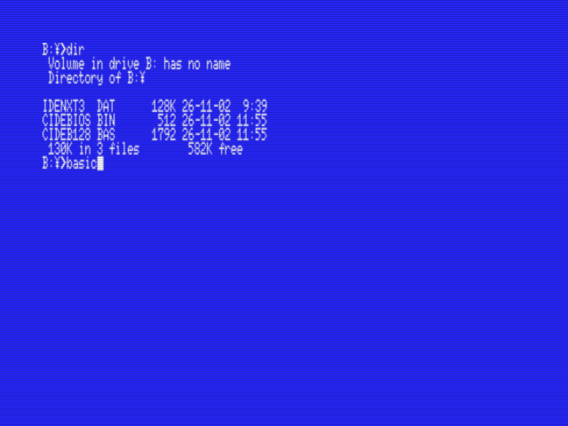
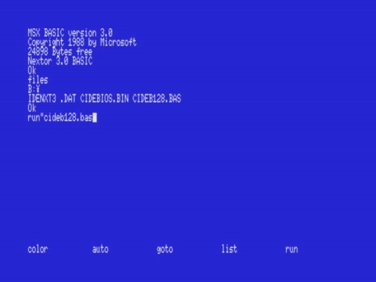
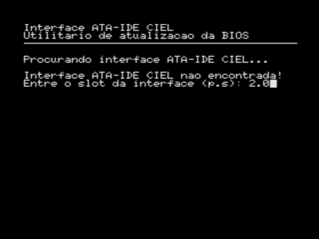
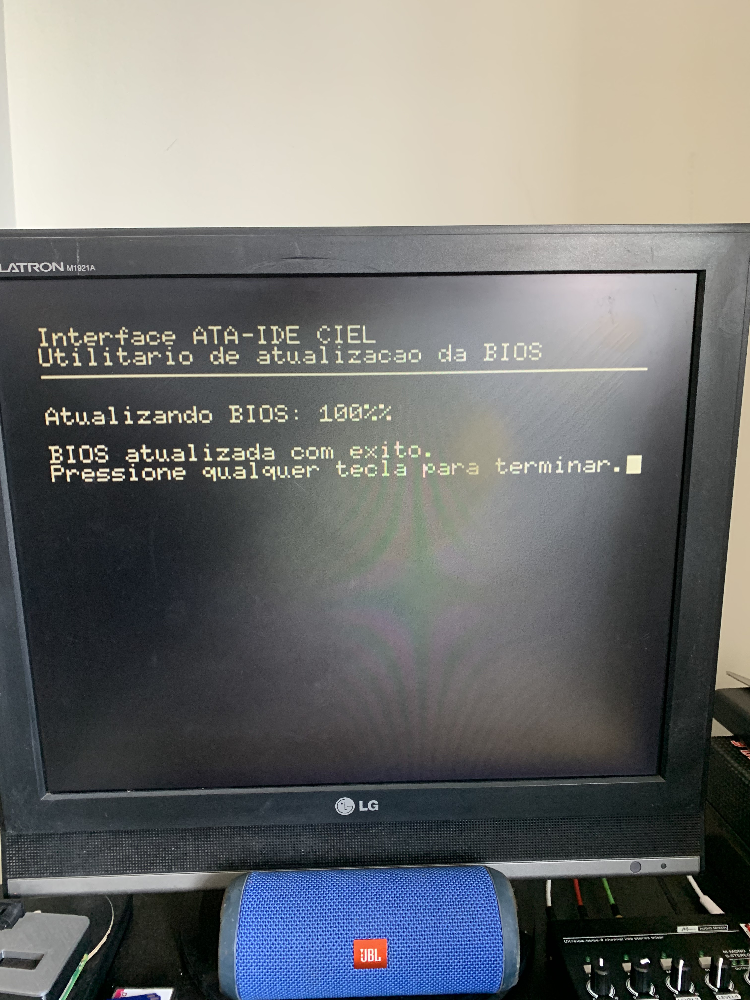
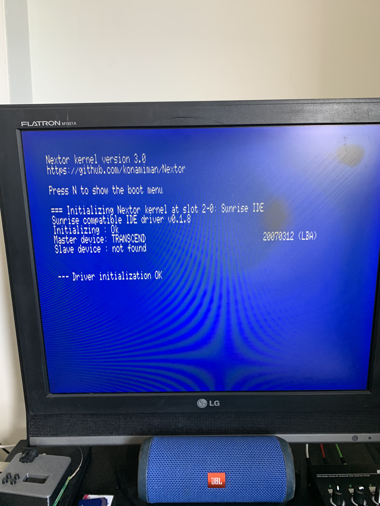
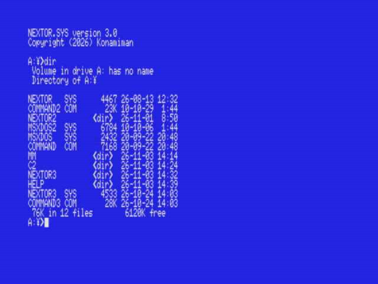

É necessário ter outro dispositivo de armazenamento (SDMapper, Pico, PicoVerse, disquete) para fazer a atualização. Copie os arquivos abaixo para uma pasta do seu CF ou SD e renomeie a ROM para IDENXT3.DAT

* [CIDEB128.BAS](https://www.konamiman.com/msx/misc/IDE/CIDEB128.BAS)

* [CIDEBIOS.BIN](https://www.konamiman.com/msx/misc/IDE/CIDEBIOS.BIN)

* [Nextor-3.0.0.SunriseIDE.ROM](https://github.com/Konamiman/SunriseIDE-Nextor-driver/releases/download/v0.1.8-blueMSX-v0.1.5-Nextor-3.0/Nextor-3.0.0.SunriseIDE.ROM)

Com tudo pronto inicie o MSX. O processo será feito 'dentro' do BASIC então, se for o caso, no prompt do MSX-DOS acesse a pasta onde copiou os arquivos (CD 'nome_da_pasta') e depois digite BASIC seguido do 'ENTER'.

No BASIC o comando 'FILES' deve listar os arquivos acima, então digitamos RUN"CIDEB128.BAS" (com as aspas).

O programa vai perguntar em que slot(.subslot) está o cartucho IDE, no meu caso que uso um expansor no slot 2 do Pana A1WX com a IDE no primeiro slot digito "2.0" (sem as aspas e com o ponto).

A atualização é lenta então tenha paciencia. ;-P

Ao final você deve reiniciar o MSX e verá a mensagem da versão 3 e firmware da IDE na versão 0.1.8.

Agora devemos preparar o cartão CF ou SD com os novos programas da versão 3. Se você usa o mesmo cartão em outros cartuchos é possível manter a versão 2, um dual-boot na era dos 8-bits. Nesse caso minha sugestão é criar uma nova pasta e copiar os arquivos da versão 3 pra ela.

Baixe o [zip](https://github.com/Konamiman/Nextor/releases/download/tools-disk-image-and-zip-for-Nextor-3.0/tools.zip) com os novos programas/utilitários, descompacte e copie para a pasta no CF ou SD. Depois copie os arquivos NEXTOR.SYS e COMMAND3.COM para a raiz do cartão. **Atenção!** Caso queira manter a versão 2 renomeio o .SYS para NEXTOR3.SYS antes de copiá-lo. 

Pronto. Ao reiniciar o MSX a versão 3 estará rodando.

Vale ler a [documentação](https://github.com/Konamiman/Nextor/blob/master/docs/Nextor_3.0_Whats_New.md) da nova versão, tem muita coisa nova e algumas atualizações.
